# Beat Overlay

<p align="center">
  
</p>

<p align="center"><b>Control and Focus on your beats</b></p>

**Beat Overlay** is an Android app that draws a thin floating rhythm bar over any other app or game. Use it for rhythm training, tempo practice or focus. Beat markers scroll along the bar, your phone ticks on every beat, and the tempo can speed up, drift, pause and rest on its own.

---

## Features

**Rhythm**
- **Tempo and speed-up**: set a start BPM, how fast it speeds up (% per minute) and a max BPM. The speed-up is exponential.
- **Random pauses**: the bar freezes at random times, with a countdown before it restarts.
- **Slow rests**: calm, slow-tempo periods. They can replace a pause, follow a pause, or start by themselves at random times.
- **Random tempo drift**: the tempo wanders a little, and the drift can grow over time.
- **Haptics**: a vibration tick on every beat, with your own strength and length.

**The bar**
- Floats over other apps and never takes focus, so your game or app keeps working underneath.
- Set width, thickness, opacity, edge fade and vertical position. Drag the bar to move it.
- Optional up/down arrows (fade out, always, or off).
- **Beat marker**: a circle, or your own picture (PNG, JPG, WebP or SVG, including the Beat Overlay logo).
- **Gestures on the bar**: hold, double tap, triple tap, swipe left and swipe right. Each one can open the app, pause or resume, stop the overlay, start a slow rest, reset the tempo, hide the bar for 10 seconds, or do nothing.

**The app**
- **Home**: all tempo, pause, rest and drift settings. Changes wait until you press **Apply**, so the running overlay is not disturbed while you edit. If you leave Home with unapplied changes, the app asks: Apply, Discard or Keep editing.
- **Presets**: save your own, or use the built-in ones (Default, Warm-up, Endurance, Chaos).
- **Settings**: theme (System, Light, Dark), bar layout, reduce motion, haptics, gestures, setup and backup.
- **Backup**: export and import everything as a JSON file.
- **First-time setup**: permissions, bar size and a gesture tutorial. You can run it again from Settings.
- **Bottom bar**: Home, Presets, Settings, Apply, a combined Start / Pause / Resume button, and a Stop button that only shows while the overlay runs.
- **Look and feel**: Material 3 Expressive style, with a collapsing header, springy button animations and slide-and-fade screen changes. Turn on **Reduce motion** to skip the animations.

---

## Requirements

| | |
|---|---|
| Android | 8.0 (API 26) or newer |
| Target SDK | 34 |
| Language | Kotlin 1.9.24 |
| Build tools | Android Gradle Plugin 8.5.2, Gradle 8.14.3, JDK 17 |
| UI | Plain Android Views, built in code (no Compose, no XML layouts) |
| Libraries | `androidx.core:core-ktx`, `com.caverock:androidsvg-aar` |

## Permissions

| Permission | Why |
|---|---|
| Display over other apps (`SYSTEM_ALERT_WINDOW`) | Draws the bar over other apps. **Required.** |
| Foreground service (special use) | Keeps the bar running while you use other apps. |
| Notifications (`POST_NOTIFICATIONS`) | Shows the service notification. Optional. |
| Vibrate | Beat and button haptics. |

---

## Install

**From a release:** download the APK from the [Releases](https://github.com/phac2000/BeatOverlay/releases) page and open it on your phone. Allow "install unknown apps" if Android asks.

**From source:**

```bash
git clone https://github.com/phac2000/BeatOverlay.git
cd BeatOverlay
./gradlew assembleDebug
```

The APK is at `app/build/outputs/apk/debug/app-debug.apk`.

**On the phone itself:** see [BUILD_ON_PHONE.md](BUILD_ON_PHONE.md) for building with Code On The Go.

**Releases:** pushing a tag that starts with `v` (for example `v0.1.2`) runs the GitHub Actions workflow, which builds a debug APK and attaches it to the release.

## First run

1. Open Beat Overlay. The setup walks you through the permissions, the bar size and the gestures.
2. Allow **Display over other apps** when asked.
3. Tap **Start** in the bottom bar. The bar appears over your other apps.
4. Change settings on Home and press **Apply** to send them to the running bar.

---

## Project structure

```
BeatOverlay/
├── .github/workflows/release.yml   # Builds and attaches the APK on version tags
├── app/
│   ├── build.gradle.kts
│   └── src/main/
│       ├── AndroidManifest.xml
│       ├── java/com/example/beatoverlay/
│       │   ├── MainActivity.kt     # Screens, bottom bar, header, animations
│       │   ├── OverlayService.kt   # Foreground service and gesture actions
│       │   ├── BeatBarView.kt      # The bar: drawing and rhythm logic
│       │   ├── SettingsStore.kt    # Settings, presets, backup, Home staging
│       │   ├── Gestures.kt         # Drag, hold, taps and swipes on the bar
│       │   ├── MarkerImage.kt      # PNG / JPG / WebP / SVG marker import
│       │   ├── Ui.kt               # View helpers, nav items, stop button
│       │   ├── Palette.kt          # Light and dark colors
│       │   └── Keys.kt             # Names of all settings
│       └── res/
│           ├── drawable/           # Icons
│           └── raw/                # Logo SVG
├── build.gradle.kts
├── settings.gradle.kts
├── BUILD_ON_PHONE.md
└── LICENSE
```

## Good to know

- Rotating the screen drops unapplied Home edits.
- Tapping the tab you are already on does nothing.
- Beat Overlay uses only the generic beat-bar idea. It contains no characters or assets from any other game or app.

---

## License

Released under the [MIT License](LICENSE).
